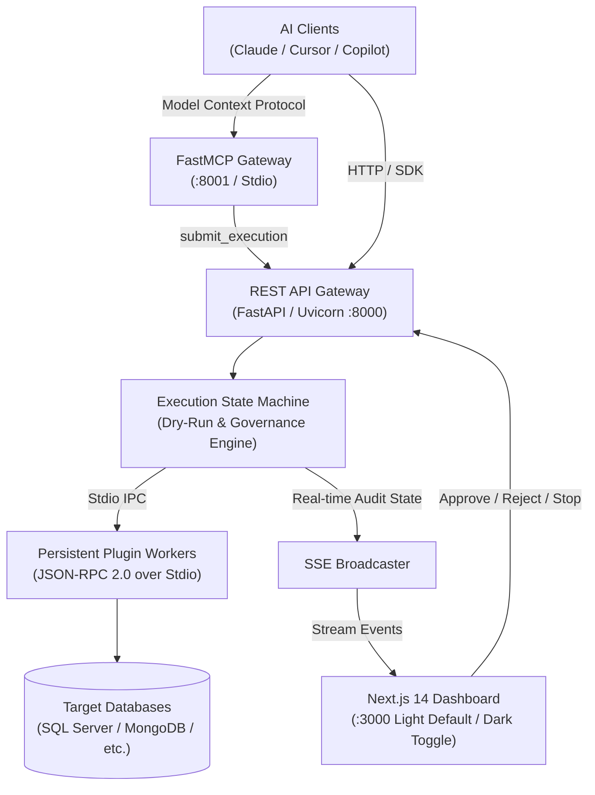

# AegisGate

[](https://fastapi.tiangolo.com)
[](https://nextjs.org)
[](https://www.typescriptlang.org/)
[](https://www.python.org/)
[](https://tailwindcss.com/)
[](LICENSE)

> **AegisGate** is an enterprise AI Execution Proxy and Pluggable Harness Platform that stands securely between **AI Agents** and **Target Data Systems** (Microsoft SQL Server, MongoDB, PostgreSQL, and internal databases).

Built around the core architectural philosophy of **"Total Decoupling & Process Isolation"**, AegisGate Core is completely vendor-agnostic. All vendor-specific operations (connection pooling, transactions, explain plans, query execution, and emergency termination) are encapsulated within independent, pluggable modules communicating via **JSON-RPC 2.0 over Stdio**.

---

## 🏛 System Architecture



---

## ⚡ Quick Start (5 Commands)

Get a clean clone running locally in under 5 minutes:

```bash
# 1. Install Python dependencies in your active environment
pip install -e ".[dev]"

# 2. Install Frontend dependencies
cd frontend && npm install && cd ..

# 3. Seed demonstration data (schema catalog, rules, sample executions)
python scripts/tasks.py seed

# 4. Start Backend + Frontend together
python scripts/tasks.py dev
```

Open [http://localhost:3000](http://localhost:3000) in your browser.

- **Frontend Dashboard:** [http://localhost:3000](http://localhost:3000) (Light theme by default, toggleable to dark)
- **Backend API & Swagger:** [http://127.0.0.1:8000/docs](http://127.0.0.1:8000/docs)
- **Health Check:** [http://127.0.0.1:8000/health](http://127.0.0.1:8000/health)

---

## 🧪 Simulation vs Real SQL Server

AegisGate includes a reference **SQL Server Plugin** (`plugins/sqlserver_plugin`) that operates in two modes:

### 1. Simulation Mode (Default - Zero Database Required)
- **Default configuration:** `"use_simulation": "true"` in `plugin_manifest.json`.
- Returns deterministic, realistic enterprise schema catalogs (`Finance` and `Inventory` partitions).
- Generates realistic execution plans (e.g. `Clustered Index Scan`, cost statistics).
- Simulates query execution and mock latency without needing a physical Microsoft SQL Server or ODBC drivers.
- Ideal for development, UI verification, and AI workflow testing.

### 2. Real SQL Server Connection
To connect to a live Microsoft SQL Server:
1. Install the SQL Server extra:
   ```bash
   pip install -e ".[sqlserver]"
   ```
2. Ensure [Microsoft ODBC Driver 18 for SQL Server](https://learn.microsoft.com/en-us/sql/connect/odbc/download-odbc-driver-for-sql-server) is installed on your OS.
3. Open the Dashboard at [http://localhost:3000](http://localhost:3000), click **Configure** on the SQL Server card, set `use_simulation` to `false`, enter host/port/database credentials, and click **Save Configuration**.

---

## 🎨 Theme & User Interface

- **Default Theme:** **Light Mode** designed for optimal daytime contrast and corporate readability.
- **Theme Toggle:** Sun/Moon toggle in the header smoothly switches between Light and Dark mode.
- **Persistence:** User theme preference is stored in `localStorage` and persists across page reloads.
- **Contrast Overrides:** Strict WCAG AA contrast rules defined in `frontend/src/app/globals.css`.

---

## 📂 Project Directory Structure

```text
AegisGate/
├── backend/                     # Compatibility root entrypoint (main.py)
├── core/                        # Core Platform Platform (FastAPI & MCP)
│   ├── config.py                # Pydantic Settings & environment limits
│   ├── database.py              # SQLite SQLModel entities & auto-seeding
│   ├── exceptions.py            # Domain exceptions
│   ├── main.py                  # FastAPI lifespan & application router
│   ├── engine/                  # State Machine, Governance, Linter, and Worker IPC
│   ├── gateway/                 # REST API, Schemas, FastMCP, and SSE Broadcaster
│   └── storage/                 # Knowledge, Rule, and Audit Log stores
├── data/                        # Internal storage directory (*.db is git-ignored)
│   ├── aegisgate.db             # Central SQLite database (auto-created on first start)
│   └── knowledge_docs/          # Markdown context (doc.md, skills.md)
├── docs/                        # Architectural rulebooks & documentation
│   ├── architecture.md          # Active system architecture specification
│   ├── configuration.md         # Environment variables & configuration dictionary
│   └── archive/                 # Historical planning documents
├── frontend/                    # Next.js 14 App Router Dashboard
│   ├── src/app/                 # Layout, styling (globals.css), and main dashboard
│   ├── src/components/          # Monitor, Rules, Audit, and Modal components
│   └── package.json             # Dependencies (Next.js, Tailwind, Vitest)
├── plugins/                     # Pluggable database adapters
│   ├── plugin_contract.py       # JSON-RPC 2.0 interface specification
│   ├── sql_inspector.py         # Token-based SQL safety parser
│   └── sqlserver_plugin/        # Reference SQL Server adapter
├── scripts/                     # Cross-platform developer scripts
│   ├── tasks.py                 # Task runner: dev, test, check, seed, clean
│   └── seed_demo.py             # Idempotent demo data seeder
├── sdk/                         # Official Plugin Development SDK
│   └── aegisgate_sdk/           # BasePlugin, PluginServer, and models
├── tests/                       # Automated test suite (pytest & vitest)
├── pyproject.toml               # PEP 621 Python packaging configuration
└── Makefile                     # Thin wrapper forwarding to scripts/tasks.py
```

---

## 🛠 Everyday Development Commands

Use the cross-platform task runner `scripts/tasks.py` (or `make <target>`):

```bash
# Start backend + frontend with unified prefixed logs
python scripts/tasks.py dev

# Run all backend unit tests + frontend vitest
python scripts/tasks.py test

# Run complete CI suite (ruff, mypy, pytest, eslint, tsc, vitest)
python scripts/tasks.py check

# Seed or refresh demo data
python scripts/tasks.py seed

# Prune old audit logs and archive to ndjson.gz
python scripts/tasks.py prune [--dry-run]

# Remove temporary files and build caches
python scripts/tasks.py clean
```

For advanced multi-process deployment, clustering, and retention runbooks, see [docs/operations.md](docs/operations.md).
