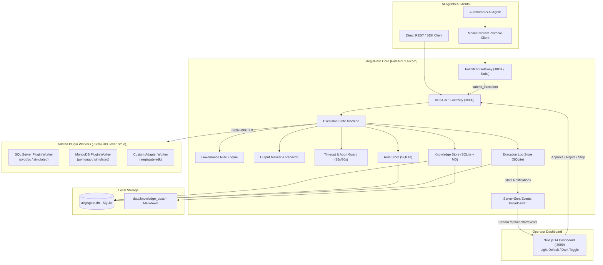
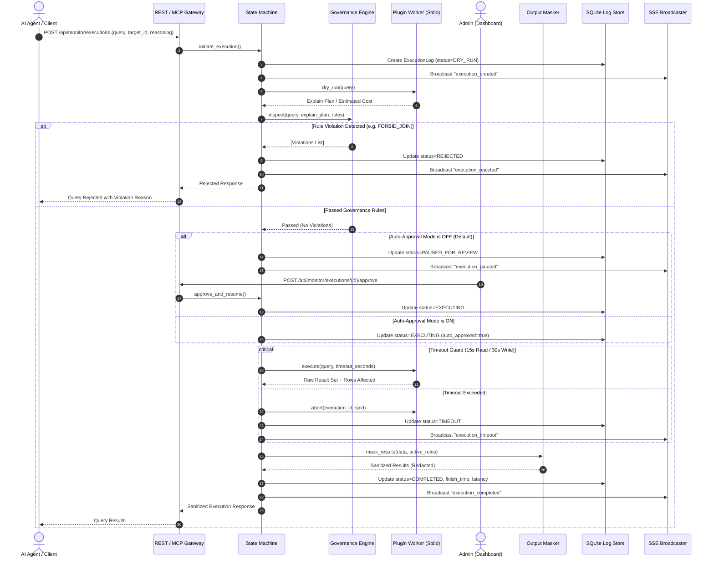
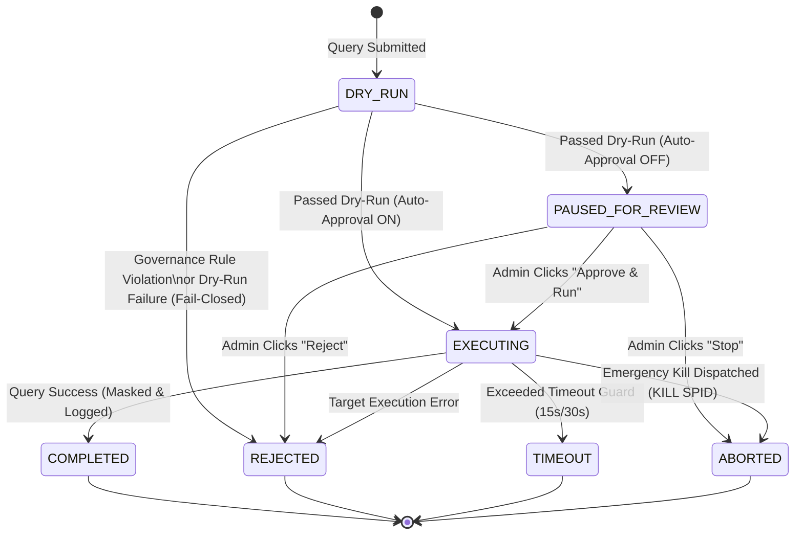

# AegisGate System Architecture

AegisGate is an enterprise-grade, zero-trust AI execution proxy and pluggable harness platform designed to run locally between **Autonomous AI Agents** and **Target Data Systems** (SQL Server, MongoDB, PostgreSQL, and custom APIs).

It enforces zero-touch discovery, pre-execution dry-run inspections, governance rule enforcement, human-in-the-loop approvals, and strict timeout guards.

---

## 1. System Component Map

---

## 2. Request Lifecycle Sequence

Every AI query follows a strict, verifiable lifecycle before touching target storage:

---

## 3. Execution Status State Machine

The query lifecycle is formalized into a strict state machine:

---

## 4. Plugin Architecture & Protocol

AegisGate enforces complete vendor decoupling: **The Core engine is completely unaware of database dialects.**

All target-specific connectivity, authentication, query syntax, plan inspection, and cancellation are encapsulated within plugins that communicate via **JSON-RPC 2.0 over Stdio**.

### 4.1 Execution Modes: One-Shot vs `--serve` Persistent Workers
1. **Persistent Worker (`--serve`)**:
   Plugins run as long-lived subprocesses managed by `core.engine.plugin_client.PluginClientManager`. The process starts on first query, maintains persistent connection pools, and accepts sequential or multiplexed JSON-RPC requests over standard input/output.
2. **One-Shot Invocation**:
   For testing or isolated scripts, plugins can be invoked on-demand with automatic process cleanup in a `try...finally` block.

### 4.2 Standard 4-Port Interface
Every plugin implements four core RPC methods:
- `sync_knowledge(config)`: Scans database schemas, partitions, tables, columns, indexes, and returns structured metadata.
- `dry_run(query, config)`: Generates the execution plan without committing state changes (e.g. `SET SHOWPLAN_XML ON`, `EXPLAIN`).
- `execute(query, timeout, config)`: Executes the SQL/command within the allocated timeout window.
- `abort(execution_id, spid, config)`: Dispatches emergency termination commands (e.g. `KILL {spid}`, `db.killOp`).

### 4.3 Reinitialization & Configuration Push
When an operator modifies connection credentials in the dashboard, the Core dispatches a `reinit(new_config)` RPC call to the running worker, reloading connections without needing a process restart.

---

## 5. Process & Threading Model (Single-Process Constraint)

### Current Architecture (Phase 1 Baseline)
In the current architecture, AegisGate Core runs as **one Uvicorn process**:
- **SSE Event Bus**: The subscriber queues live entirely in the memory (`asyncio.Queue`) of the running process.
- **Worker Subprocesses**: Persistent worker processes (`adapter.py --serve`) are child processes attached to the main Uvicorn PID.
- **Abort Routing**: Active session SPIDs and cancellation events are held in memory lookup tables (`_active_sessions`).

> [!IMPORTANT]
> **Single-Process Constraint**: Running Uvicorn with multiple workers (`--workers 4`) or behind multiple process replicas is currently unsupported because in-memory SSE distribution and abort dispatching are local to one process.
> **Roadmap Note**: Phase 4 will lift this constraint by decoupling process state with a shared Redis/message queue layer for distributed proxy scaling.

---

## 6. Data Model

AegisGate manages its state in SQLite (`data/aegisgate.db`) via SQLModel:

1. **`PluginProfile`**: Installed plugins, entrypoints, connection configuration JSON, dynamic UI schema, and certification state.
2. **`KnowledgeChunk`**: Partitioned structural catalog metadata and references to filesystem markdown documentation.
3. **`Rule`**: Governance rules (`FORBID_JOIN`, `FORBID_TABLE_SCAN`, `MAX_EXECUTION_TIME`, `CUSTOM`, `REDACT_FIELD`, `REMOVE_FIELD`).
4. **`ExecutionLog`**: Comprehensive audit log recording query text, explain plans, violations, timings, SPIDs, auto-approval flags, and sanitized result summaries.
5. **`SystemSetting`**: Runtime toggle state (e.g. `auto_approval_mode`).

---

## 7. Extension Points

1. **Adding a New Governance Rule Type**:
   - Register the rule type string in `core.engine.governance.RULE_TYPES`.
   - Implement inspection logic in `core.engine.governance.GovernanceEngine.inspect_query()`.
   - Update `plugins.sql_inspector` if tokenized parsing is required.
   - Update `frontend/src/components/KnowledgeAndRules.tsx` to add UI form fields.
2. **Adding a New Database Plugin**:
   - Create a folder under `plugins/<new_plugin>/`.
   - Create `plugin_manifest.json` with entrypoint `python adapter.py --serve`.
   - Inherit from `aegisgate_sdk.BasePlugin` and implement `sync_knowledge`, `dry_run`, `execute`, and `abort`.
   - Run `python -m pytest tests/test_plugin_linter.py` to achieve certification.
3. **Adding a New Dashboard UI Feature**:
   - Add modular components in `frontend/src/components/`.
   - Connect to real-time events via `useSSE` hook in `frontend/src/lib/sse.ts`.
   - Ensure light-theme contrast adherence in `frontend/src/app/globals.css`.

