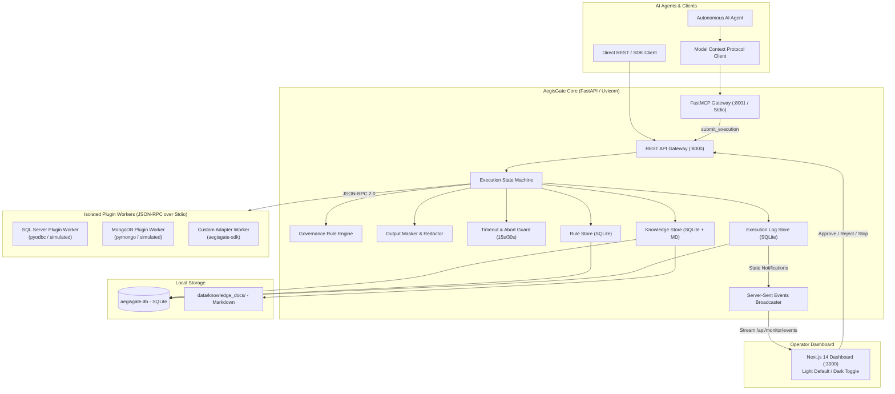
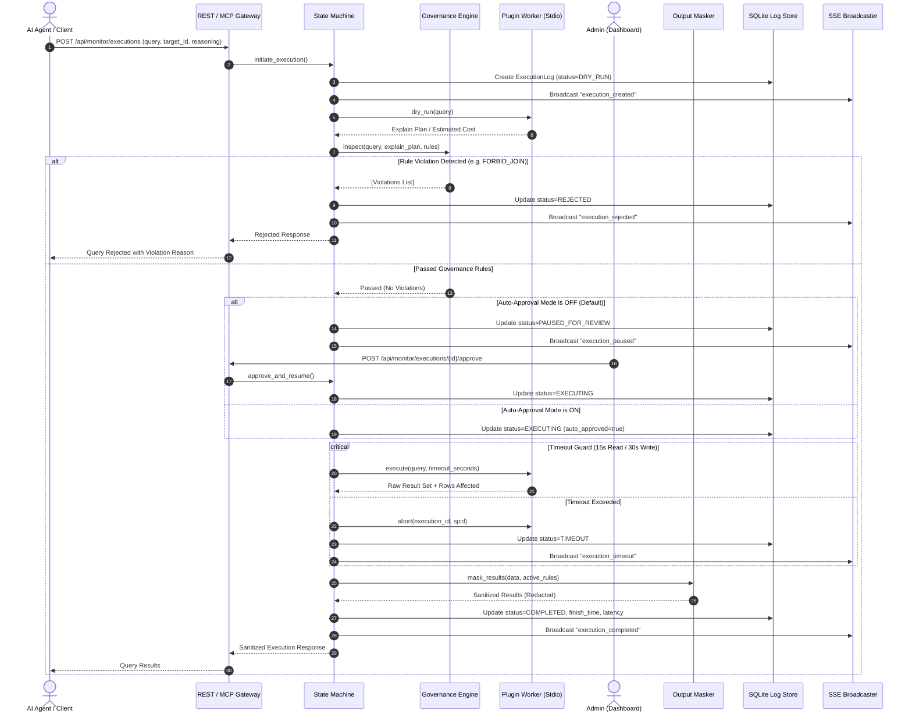
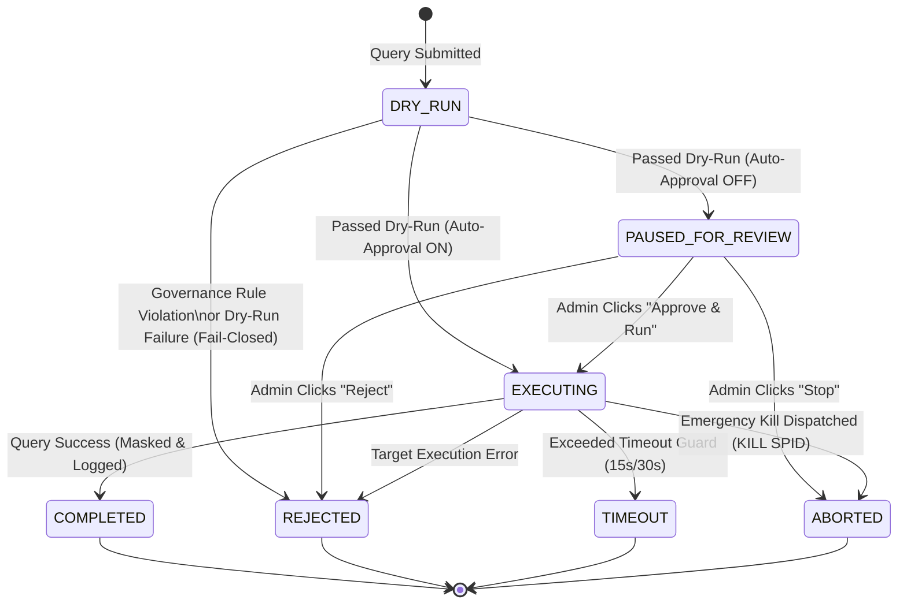
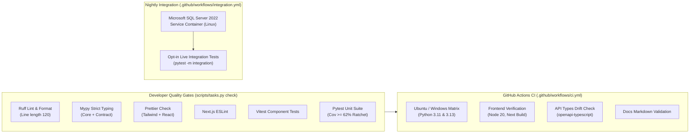
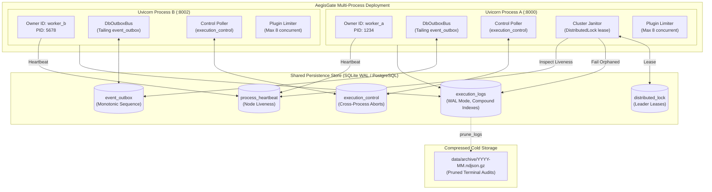

# AegisGate System Architecture

AegisGate is an enterprise-grade, zero-trust AI execution proxy and pluggable harness platform designed to run locally between **Autonomous AI Agents** and **Target Data Systems** (SQL Server, MongoDB, PostgreSQL, and custom APIs).

It enforces zero-touch discovery, pre-execution dry-run inspections, governance rule enforcement, human-in-the-loop approvals, and strict timeout guards.

---

## 1. System Component Map

---

## 2. Request Lifecycle Sequence

Every AI query follows a strict, verifiable lifecycle before touching target storage:

---

## 3. Execution Status State Machine

The query lifecycle is formalized into a strict state machine:

---

## 4. Plugin Architecture & Protocol

AegisGate enforces complete vendor decoupling: **The Core engine is completely unaware of database dialects.**

All target-specific connectivity, authentication, query syntax, plan inspection, and cancellation are encapsulated within plugins that communicate via **JSON-RPC 2.0 over Stdio**.

### 4.1 Execution Modes: One-Shot vs `--serve` Persistent Workers
1. **Persistent Worker (`--serve`)**:
   Plugins run as long-lived subprocesses managed by `core.engine.plugin_client.PluginClientManager`. The process starts on first query, maintains persistent connection pools, and accepts sequential or multiplexed JSON-RPC requests over standard input/output.
2. **One-Shot Invocation**:
   For testing or isolated scripts, plugins can be invoked on-demand with automatic process cleanup in a `try...finally` block.

### 4.2 Standard 4-Port Interface
Every plugin implements four core RPC methods:
- `sync_knowledge(config)`: Scans database schemas, partitions, tables, columns, indexes, and returns structured metadata.
- `dry_run(query, config)`: Generates the execution plan without committing state changes (e.g. `SET SHOWPLAN_XML ON`, `EXPLAIN`).
- `execute(query, timeout, config)`: Executes the SQL/command within the allocated timeout window.
- `abort(execution_id, spid, config)`: Dispatches emergency termination commands (e.g. `KILL {spid}`, `db.killOp`).

### 4.3 Reinitialization & Configuration Push
When an operator modifies connection credentials in the dashboard, the Core dispatches a `reinit(new_config)` RPC call to the running worker, reloading connections without needing a process restart.

---

## 5. Process & Threading Model (Single-Process Constraint)

### Current Architecture (Phase 1 Baseline)
In the current architecture, AegisGate Core runs as **one Uvicorn process**:
- **SSE Event Bus**: The subscriber queues live entirely in the memory (`asyncio.Queue`) of the running process.
- **Worker Subprocesses**: Persistent worker processes (`adapter.py --serve`) are child processes attached to the main Uvicorn PID.
- **Abort Routing**: Active session SPIDs and cancellation events are held in memory lookup tables (`_active_sessions`).

> [!IMPORTANT]
> **Single-Process Constraint**: Running Uvicorn with multiple workers (`--workers 4`) or behind multiple process replicas is currently unsupported because in-memory SSE distribution and abort dispatching are local to one process.
> **Roadmap Note**: Phase 4 will lift this constraint by decoupling process state with a shared Redis/message queue layer for distributed proxy scaling.

---

## 6. Data Model

AegisGate manages its state in SQLite (`data/aegisgate.db`) via SQLModel:

1. **`PluginProfile`**: Installed plugins, entrypoints, connection configuration JSON, dynamic UI schema, and certification state.
2. **`KnowledgeChunk`**: Partitioned structural catalog metadata and references to filesystem markdown documentation.
3. **`Rule`**: Governance rules (`FORBID_JOIN`, `FORBID_TABLE_SCAN`, `MAX_EXECUTION_TIME`, `CUSTOM`, `REDACT_FIELD`, `REMOVE_FIELD`).
4. **`ExecutionLog`**: Comprehensive audit log recording query text, explain plans, violations, timings, SPIDs, auto-approval flags, and sanitized result summaries.
5. **`SystemSetting`**: Runtime toggle state (e.g. `auto_approval_mode`).

---

## 7. Extension Points

1. **Adding a New Governance Rule Type**:
   - Register the rule type string in `core.engine.governance.RULE_TYPES`.
   - Implement inspection logic in `core.engine.governance.GovernanceEngine.inspect_query()`.
   - Update `plugins.sql_inspector` if tokenized parsing is required.
   - Update `frontend/src/components/KnowledgeAndRules.tsx` to add UI form fields.
2. **Adding a New Database Plugin**:
   - Create a folder under `plugins/<new_plugin>/`.
   - Create `plugin_manifest.json` with entrypoint `python adapter.py --serve`.
   - Inherit from `aegisgate_sdk.BasePlugin` and implement `sync_knowledge`, `dry_run`, `execute`, and `abort`.
   - Run `python -m pytest tests/test_plugin_linter.py` to achieve certification.
3. **Adding a New Dashboard UI Feature**:
   - Add modular components in `frontend/src/components/`.
   - Connect to real-time events via `useSSE` hook in `frontend/src/lib/sse.ts`.
   - Ensure light-theme contrast adherence in `frontend/src/app/globals.css`.

---

## 8. Test Infrastructure, Quality Gates & CI Architecture

Phase 2 established committed, enterprise-grade quality gates and automated test infrastructure across the backend and frontend:

### 8.1 Domain-Driven Test Organization
Tests are decoupled from development phases and structured by domain subsystem under `tests/unit/`:
- `governance/`: Cost limits, table scan bans, join restrictions, and query AST analysis.
- `sql_inspector/`: SQL tokenization and dialect-neutral identifier extraction.
- `output_masker/`: Sanitization algorithms (`REDACT_FIELD`, `REMOVE_FIELD`, nested JSON structures).
- `state_machine/`: Formal state transitions, dry-run evaluation, auto-approval heuristics, and lifecycle simulation.
- `timeout_guard/`: Query deadline enforcement and child process cancellation.
- `plugin_installer/`: Manifest discovery, dynamic schema validation, zip file hardening, and lifecycle management.
- `plugin_client/`: JSON-RPC 2.0 communication over stdio with isolated persistent worker processes.
- `plugin_registry/`: Plugin directory discovery and runtime profiling.
- `mcp_gateway/`: FastMCP protocol integration and execution submission endpoints.
- `api/`: REST routing, dependency injection, and configuration drift guards.
- `sdk/`: Public client and BasePlugin SDK contracts.
- `storage/`: SQLModel entity persistence and SQLite database migrations.

### 8.2 Test Isolation & Repository Pollution Guard
To eliminate disk side-effects during automated test runs:
- **`tmp_plugins_dir` fixture**: Dynamically isolates `settings.PLUGINS_DIR` to a temporary directory with bundled plugin copies, preventing custom or dynamically installed plugins from dirtying `plugins/`.
- **`db_session` fixture**: Uses an in-memory or ephemeral SQLite database for complete test isolation.
- **`worker_cleanup` fixture**: Autouse fixture guaranteeing that all child worker processes terminate at the conclusion of each test.
- **Pollution Guard (`pytest_sessionfinish`)**: A global hook executes `git status --porcelain` at session completion and immediately aborts the test run if untracked files or unstaged changes are detected in `plugins/`, `data/`, or the repo root.

### 8.3 Shared API Types & Synchronization Guard
The contract between backend FastAPI endpoints and frontend React components is strictly typed:
1. `scripts/gen_api_types.py` fetches the OpenAPI 3.1 specification from FastAPI.
2. `openapi-typescript` translates the schema into TypeScript interfaces saved in `frontend/src/types/api.generated.ts`.
3. `frontend/src/types/index.ts` re-exports and aliases these types for consumption by React hooks and components.
4. CI checks for drift by re-running the generation script and failing if `git diff` is non-empty.

---

## 9. Multi-Process Scale & Data Lifecycle Architecture

To scale beyond a single Uvicorn process and sustain heavy production workloads, AegisGate implements a distributed, multi-process architecture with zero external runtime dependencies (using SQLite in WAL mode or PostgreSQL).

### 9.1 Database Engine Concurrency & SQLite WAL Mode
- **WAL Journaling**: Configured with `PRAGMA journal_mode=WAL` and `PRAGMA synchronous=NORMAL`, enabling non-blocking concurrent reads alongside active writes.
- **QueuePool Tuning**: Replaced default `NullPool` with SQLAlchemy `QueuePool(pool_size=20, max_overflow=30, pool_timeout=30.0)` and `PRAGMA busy_timeout=15000` to eliminate connection starvation under high concurrency.
- **Alembic Schema Evolution**: Programmatic migration execution with programmatic autostamp (`001_initial_baseline`, `002_scale_infrastructure`).

### 9.2 Distributed Event Bus & SSE Replay
- Abstract `EventBus` contract decoupling event publication from transport.
- `InMemoryBus`: Circular ring buffer of 200 events for single-process local development.
- `DbOutboxBus`: Writes monotonic events to `event_outbox` table and tails changes every 150ms.
- **SSE Last-Event-ID**: Dashboard reconnects transparently replay missed events using standard `Last-Event-ID` header or `?last_event_id=` query parameter.

### 9.3 Process Ownership, Cross-Process Aborts & Heartbeat Janitor
- **Process Ownership**: Each process instance generates a unique `owner_id`. Executions record their `owner_id` and `started_at` upon transitioning into `EXECUTING`.
- **Cross-Process Abort**: When an operator aborts an execution on Node A that is running on Node B:
  1. Node A claims `ABORTED` status via atomic CAS in `execution_logs`.
  2. Node A enqueues an `ABORT` command in `execution_control`.
  3. Node B's background control poller receives the instruction, cancels the running query / kills the target SPID via its local worker, and records `handled_at`.
- **Cluster Janitor**: Uses `DistributedLock` to elect a single leader. Detects stranded executions whose owner process has crashed (`last_seen > 30s`) and marks them `FAILED` with error `"owner process died"`.

### 9.4 Bounded Concurrency Queues & Backpressure
- Per-plugin `PluginConcurrencyLimiter` enforces bounded concurrency (default: 8 concurrent executions per adapter).
- Queries exceeding slot availability wait in state `QUEUED` and emit `execution_queued` SSE events.
- If queue depth exceeds `PLUGIN_QUEUE_MAXSIZE` (100), requests are rejected with `HTTP 429 Too Many Requests`.
- Non-blocking submission (`POST /api/monitor/executions?wait=false`) returns `HTTP 201 Created` immediately with execution ID while dispatching background workers.

### 9.5 Cursor Pagination & Result Truncation
- Stable cursor encoding based on `(created_at, id)` via endpoint `GET /api/executions/page`.
- Substring search across `query`, `reasoning`, and `id`.
- Enforcement of `RESULT_MAX_BYTES` (50,000 bytes) truncating massive result payloads while preserving row counts.

### 9.6 Data Retention & Archival
- `core/storage/retention.py` provides automated log lifecycle management:
  - Prunes terminal logs (`COMPLETED`, `REJECTED`, `TIMEOUT`, `ABORTED`, `FAILED`) older than `LOG_RETENTION_DAYS`.
  - Never touches active executions (`QUEUED`, `EXECUTING`, `PAUSED_FOR_REVIEW`, `DRY_RUN`).
  - Automatically exports pruned logs to compressed `data/archive/YYYY-MM.ndjson.gz` archives.
  - Scrubs bulky `result_summary` fields for surviving logs older than `RESULT_RETENTION_DAYS`.
  - Prunes stale outbox events older than `OUTBOX_RETENTION_HOURS` (24h).

