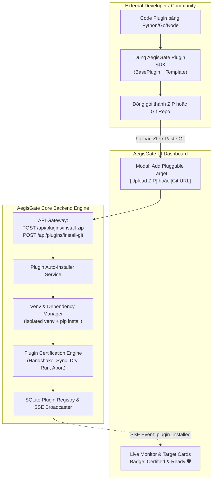

# AegisGate Plugin Ecosystem Upgrade Plan (Ideas 1, 2, 5)
## Hệ sinh thái Plugin Linh hoạt: SDK Template, 1-Click Hot-Install & Automated Certification

Tài liệu này đặc tả kiến trúc, luồng hoạt động, cấu trúc mã nguồn và lộ trình triển khai chi tiết cho việc nâng cấp hệ thống Plugin của AegisGate theo 3 trụ cột chiến lược:
1. **Trụ cột 1 (Ý tưởng 1): AegisGate Plugin SDK & Starter Template** — Chuẩn hóa phát triển plugin ngoài, giấu nhẹm độ phức tạp JSON-RPC.
2. **Trụ cột 2 (Ý tưởng 2): 1-Click Hot-Install từ ZIP / Git / Folder** — Nạp nóng, tự động tạo isolated venv và cài dependencies không cần khởi động lại Core.
3. **Trụ cột 3 (Ý tưởng 5): Plugin Certification Linter & Self-Verification** — Tự động chạy Sanity Test 4 bước và cấp chứng nhận tương thích (Certified Badge).

---

## 1. Kiến trúc Tổng thể (High-Level Architecture)



---

## 2. Chi tiết Thiết kế 3 Phân hệ Nâng cấp

### 2.1. Phân hệ 1: AegisGate Plugin SDK & Starter Template (Ý tưởng 1)

#### Mục tiêu:
* Lập trình viên bên ngoài không cần biết chi tiết vòng lặp `sys.stdin.readline()` hay cấu trúc gói JSON-RPC 2.0.
* Cung cấp thư viện lõi `aegisgate_sdk` và CLI `create-aegisgate-plugin`.

#### Cấu trúc Thư mục Starter Template:
```text
plugins/templates/starter/
├── manifest.json              # Khai báo metadata, UI Schema, commands
├── adapter.py                 # Kế thừa BasePlugin, chỉ override 4 hàm
├── requirements.txt           # Thư viện phụ thuộc (e.g. psycopg2, redis, snowflake-connector)
├── README.md                  # Tài liệu hướng dẫn cấu hình & biến môi trường
└── tests/
    └── test_adapter.py        # Mock standalone test runner
```

#### Thiết kế Lớp `BasePlugin` và `PluginServer` trong SDK:
```python
# sdk/aegisgate_sdk/base.py
from abc import ABC, abstractmethod
from typing import Any, Dict, List, Optional

class BasePlugin(ABC):
    """Lớp trừu tượng định nghĩa chuẩn 4 phương thức bắt buộc."""
    
    @abstractmethod
    def sync_knowledge(self, config: Dict[str, Any]) -> Dict[str, Any]:
        """Thu thập catalog database (tables, views, columns, indexes)."""
        pass

    @abstractmethod
    def dry_run(self, query: str, config: Dict[str, Any]) -> Dict[str, Any]:
        """Sinh execution plan (SHOWPLAN/EXPLAIN) và tính risk score."""
        pass

    @abstractmethod
    def execute(self, query: str, config: Dict[str, Any]) -> Dict[str, Any]:
        """Thực thi câu lệnh SQL/NoSQL và trả về kết quả."""
        pass

    @abstractmethod
    def abort(self, spid: Optional[int], config: Dict[str, Any]) -> bool:
        """Hủy khẩn cấp phiên truy vấn trên DB theo SPID/PID."""
        pass
```

```python
# sdk/aegisgate_sdk/server.py
import json
import sys
from .base import BasePlugin

class PluginServer:
    """Tự động xử lý JSON-RPC 2.0 qua Stdio, bắt exception và format lỗi chuẩn."""
    def __init__(self, plugin_instance: BasePlugin):
        self.plugin = plugin_instance

    def run(self):
        while True:
            line = sys.stdin.readline()
            if not line:
                break
            req = json.loads(line)
            req_id = req.get("id")
            method = req.get("method")
            params = req.get("params", {})
            
            try:
                if method == "sync_knowledge":
                    result = self.plugin.sync_knowledge(params.get("config", {}))
                elif method == "dry_run":
                    result = self.plugin.dry_run(params.get("query", ""), params.get("config", {}))
                elif method == "execute":
                    result = self.plugin.execute(params.get("query", ""), params.get("config", {}))
                elif method == "abort":
                    result = self.plugin.abort(params.get("spid"), params.get("config", {}))
                else:
                    raise ValueError(f"Unknown JSON-RPC method: {method}")
                
                resp = {"jsonrpc": "2.0", "id": req_id, "result": result}
            except Exception as exc:
                resp = {"jsonrpc": "2.0", "id": req_id, "error": {"code": -32603, "message": str(exc)}}
            
            sys.stdout.write(json.dumps(resp) + "\n")
            sys.stdout.flush()
```

#### Ví dụ Code Plugin Mẫu (PostgreSQL Plugin cực gọn):
```python
# plugins/postgres_plugin/adapter.py
from aegisgate_sdk import BasePlugin, PluginServer

class PostgresPlugin(BasePlugin):
    def sync_knowledge(self, config):
        return {"schemas": ["public"], "tables": [{"name": "users", "columns": ["id", "email"]}]}

    def dry_run(self, query, config):
        return {"explain_plan": {"Node Type": "Seq Scan", "Relation Name": "users"}, "risk_score": 10}

    def execute(self, query, config):
        return {"rows_affected": 1, "data": [{"id": 1, "email": "admin@aegisgate.io"}]}

    def abort(self, spid, config):
        return True

if __name__ == "__main__":
    PluginServer(PostgresPlugin()).run()
```

---

### 2.2. Phân hệ 2: 1-Click Hot-Install từ ZIP / Git / Folder (Ý tưởng 2)

#### Mục tiêu:
* Cho phép cài đặt plugin từ UI hoặc REST API mà không cần restart server hay can thiệp thủ công vào filesystem.
* Tự động quản lý virtualenv riêng biệt cho plugin để tránh xung đột dependencies với Core Backend.

#### Các Endpoint REST API Mới:
1. `POST /api/plugins/install-zip`: Nhận multipart file `.zip`, giải nén vào `plugins/<plugin_id>`.
2. `POST /api/plugins/install-git`: Clone từ Git URL (hỗ trợ tag/branch).
3. `POST /api/plugins/install-local`: Đăng ký từ một thư mục có sẵn trên server.

#### Quy trình Cài đặt & Build Tự động (Installer Workflow):
1. **Kiểm tra & Giải nén:** Giải nén gói vào thư mục `plugins/<extracted_name>`.
2. **Xác thực Manifest (`manifest.json`):** Kiểm tra các trường bắt buộc (`id`, `name`, `driver`, `entrypoint`, `ui_schema`).
3. **Tạo Môi trường Cô lập (Isolated Venv):**
   * Nếu có `requirements.txt`:
     * Tạo môi trường: `python -m venv plugins/<plugin_id>/.venv`
     * Chạy lệnh: `plugins/<plugin_id>/.venv/bin/pip install -r requirements.txt` (hoặc `Scripts\pip.exe` trên Windows).
   * Entrypoint trong manifest được tự động mapping tới Python interpreter của venv tương ứng.
4. **Kích hoạt & Lưu trữ:**
   * Lưu metadata vào bảng `pluginprofile` trong SQLite database `aegisgate.db`.
   * Khởi chạy Subprocess kiểm tra certification (Ý tưởng 5).
   * Phát sự kiện SSE `plugin_installed` lên Frontend.

#### Giao diện UI Dashboard (Modal "Add Pluggable Target"):
* Thêm 3 Tabs:
  * **Tab 1: Preset / Local Scan** (chọn các template có sẵn).
  * **Tab 2: Upload ZIP Package** (Kéo thả file `.zip` có thanh tiến trình và thông báo kết quả).
  * **Tab 3: Clone from Git** (Nhập Git Repo URL, ví dụ: `https://github.com/my-org/aegisgate-plugin-clickhouse.git`).

---

### 2.3. Phân hệ 3: Plugin Certification Linter & Self-Verification (Ý tưởng 5)

#### Mục tiêu:
* Đảm bảo plugin nạp vào hoạt động 100% ổn định, không gây crash hoặc treo tiến trình Core.
* Cung cấp bằng chứng minh bạch (Certification Report) cho người quản trị.

#### Quy trình Kiểm thử Tự động 4 Bước (Sanity Test Pipeline):

| Bước | Tên Test | Mô tả Kiểm thử | Tiêu chí Pass |
| :--- | :--- | :--- | :--- |
| **Stage 1** | **Handshake & RPC Ping** | Khởi chạy subprocess Stdio và gửi `{"jsonrpc": "2.0", "id": 1, "method": "ping"}` | Trả về response hợp lệ trong < 2 giây |
| **Stage 2** | **Sync Knowledge Schema** | Gửi method `sync_knowledge` với config mặc định | Trả về cấu trúc danh mục bảng/cột chuẩn JSON |
| **Stage 3** | **Dry-Run Analysis** | Gửi method `dry_run` với query SELECT test | Trả về `explain_plan` và `risk_score` |
| **Stage 4** | **Abort Hook Protocol** | Gửi method `abort` với mock `spid: 99999` | Trả về `true` hoặc mã trạng thái hủy an toàn |

#### Endpoint API Verification:
* `POST /api/plugins/{plugin_id}/verify`:
  * Trả về kết quả:
    ```json
    {
      "plugin_id": "postgres_analytics",
      "certified": true,
      "checks": {
        "handshake": {"status": "PASSED", "latency_ms": 12.4},
        "sync_knowledge": {"status": "PASSED", "tables_found": 8},
        "dry_run": {"status": "PASSED", "latency_ms": 18.2},
        "abort": {"status": "PASSED", "latency_ms": 5.1}
      },
      "badge": "CERTIFIED_READY",
      "verified_at": "2026-10-22T21:45:00Z"
    }
    ```

#### Hiển thị trên Giao diện UI:
* Huy hiệu xanh lá trên Thẻ Plugin: **🛡️ Certified & Ready**.
* Nếu có bước bị fail: Hiển thị badge màu đỏ **⚠️ Compatibility Issue** kèm nút **"Inspect Linter Output"** để mở Drawer xem chi tiết log lỗi JSON-RPC để sửa nhanh.

---

## 3. Lộ trình Triển khai (Execution Phases)

### Phase A: SDK Core & Boilerplate Template (Ước tính: Bước 1)
* [ ] Xây dựng package `aegisgate_sdk` trong thư mục `sdk/aegisgate_sdk`.
* [ ] Tạo `BasePlugin`, `PluginServer`, exception chuẩn.
* [ ] Tạo template mẫu tại `plugins/templates/starter` kèm tài liệu hướng dẫn.
* [ ] Viết Unit Test cho `PluginServer` và `BasePlugin` (pytest).

### Phase B: Backend Auto-Installer & Venv Service (Ước tính: Bước 2)
* [ ] Xây dựng `core/plugin_installer.py` phụ trách:
  * Giải nén file `.zip`.
  * Clone repo Git qua `subprocess` (hoặc `dulwich/git`).
  * Khởi tạo virtualenv cô lập và chạy `pip install -r requirements.txt`.
* [ ] Bổ sung các REST API Router tại `core/routers/plugins.py`:
  * `POST /api/plugins/install-zip`
  * `POST /api/plugins/install-git`
* [ ] Viết Unit Test kiểm thử luồng cài đặt và tạo venv cô lập.

### Phase C: Plugin Certification Linter Engine (Ước tính: Bước 3)
* [ ] Xây dựng `core/plugin_linter.py`:
  * Quản lý tiến trình test subprocess với timeout 5 giây.
  * Chạy tuần tự 4 Stage (Handshake, Sync, Dry-Run, Abort).
* [ ] Lưu trạng thái `is_certified` và `certification_report` vào SQLite `PluginProfile`.
* [ ] Endpoint `POST /api/plugins/{id}/verify`.

### Phase D: Nâng cấp Frontend UI & Browser Verification (Ước tính: Bước 4)
* [ ] Nâng cấp modal `AddPluginModal.tsx` trên Frontend:
  * Bổ sung Tab kéo thả ZIP và Tab nhập Git URL.
  * Hiển thị thanh tiến trình cài đặt & build venv.
* [ ] Cập nhật thẻ `PluginManagement.tsx`:
  * Hiển thị badge **🛡️ Certified** hoặc **⚠️ Warning**.
  * Bổ sung nút **"Run Sanity Check"** để test lại plugin bất kỳ lúc nào.
* [ ] Kiểm thử tự động qua Playwright Anti-Gravity Browser (Port 9222).

---

## 4. Tiêu chí Nghiệm thu (Acceptance Criteria)

1. **Clean Code & Strict Typing:**
   * Python: 100% Type Hints, không dùng `except Exception:` chung chung không log, kế thừa `BasePlugin`.
   * TypeScript: Tuân thủ Zero `any` policy, immutability, SSE lifecycle an toàn.
2. **Tính Độc lập & Cô lập Tiến trình:**
   * Mỗi plugin có virtualenv riêng, không gây xung đột package với Core Backend.
   * Plugin lỗi crash không được phép làm dừng hoặc ảnh hưởng tới tiến trình FastAPI Core.
3. **Hot-Reload Không Gián đoạn:**
   * Khi upload ZIP hoặc paste Git URL thành công, plugin lập tức hiển thị trên Sidebar và danh sách Targets mà không cần khởi động lại server.
4. **Kiểm thử Toàn diện:**
   * Pytest Backend đạt 100% Pass cho cả SDK, Installer và Linter.
   * Vitest Frontend đạt 100% Pass cho modal upload và badge certified.
   * Anti-Gravity Browser verification chạy qua Chrome Debugging không có lỗi console.

